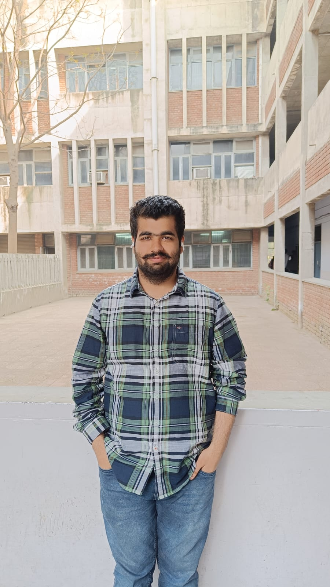

# Anuj Chalana | Portfolio

A responsive MCA graduate portfolio built with HTML and CSS. No build step, JavaScript, or package installation is required.

[View My Portfolio](https://anujchalana534-del.github.io/portfolio/)

## Preview

Open [index.html](index.html) in a browser. Edit the content in [index.html](index.html) and the design in [style.css](style.css).

## Publish on GitHub Pages

1. Create a GitHub repository. Use `<your-username>.github.io` for a profile website, or a name such as `portfolio` for a project website.
2. Upload this folder's files to the root of the repository, keeping `index.html` and `style.css` together.
3. In the repository, open **Settings > Pages**.
4. Under **Build and deployment**, choose **Deploy from a branch**.
5. Select the branch containing your files (usually `main`), choose **/ (root)**, and save.
6. Wait for the Pages deployment to finish. GitHub displays the published URL in **Settings > Pages**.

The address will be `https://<your-username>.github.io/` for a profile repository, or `https://<your-username>.github.io/<repository-name>/` for a project repository. All local asset links are relative, so either setup works.

## Personalize Before Publishing

- Confirm the graduation dates, institution names, BCA result, availability, and LinkedIn address. These are based on the original portfolio; the introduction now describes an MCA graduate as requested.
- The GitHub link points to [anujchalana534-del](https://github.com/anujchalana534-del/).
- Add your resume PDF, then change the **Request resume** email action into a download link to that file. The current action intentionally avoids a missing-file link.
- Replace the project enquiry email links with actual repository or live-demo URLs when available. Add verified technology stacks and outcomes for each project.
- Replace the initials-based portrait placeholder in the About section with your own photo using the instructions below. Add real project screenshots when available. The workspace background photograph is decorative, not a photograph of Anuj or a project screenshot.
- Update the footer year as needed.

## Add Your Portrait

Place your portrait, for example `anuj.jpg`, next to [index.html](index.html). In the `profile-portrait` figure, replace the entire `div` with class `profile-photo` (including its initials span) with:

```html

```

Remove the `Photo placeholder` span from the figure caption. The existing CSS keeps the portrait circular and crops it to fit without stretching.

## Design and Accessibility

The page includes responsive navigation, semantic sections, a keyboard skip link, visible focus states, reduced-motion support, descriptive page metadata, and a single main heading. Email links open the visitor's email application; this site does not collect or store submissions.

## External Assets

- Typography: Manrope and DM Sans via Google Fonts.
- Icons: Font Awesome 6.5.2 via cdnjs.
- Decorative workspace photograph: [Unsplash image source](https://images.unsplash.com/photo-1496181133206-80ce9b88a853), loaded from `images.unsplash.com`.

These assets require an internet connection and make requests to third-party services. The text, layout, and navigation remain usable with fallback fonts if they are unavailable. For a fully self-hosted site, download appropriately licensed assets and update their paths.
